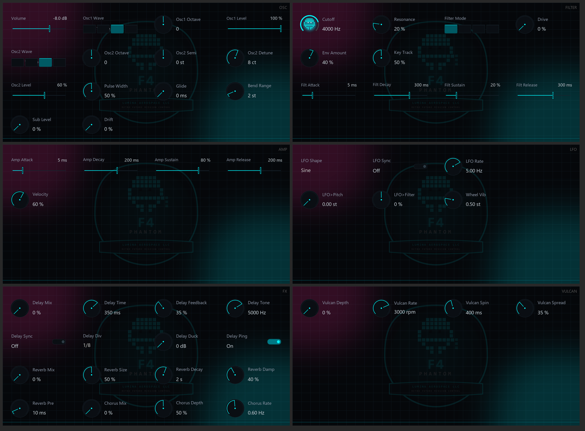
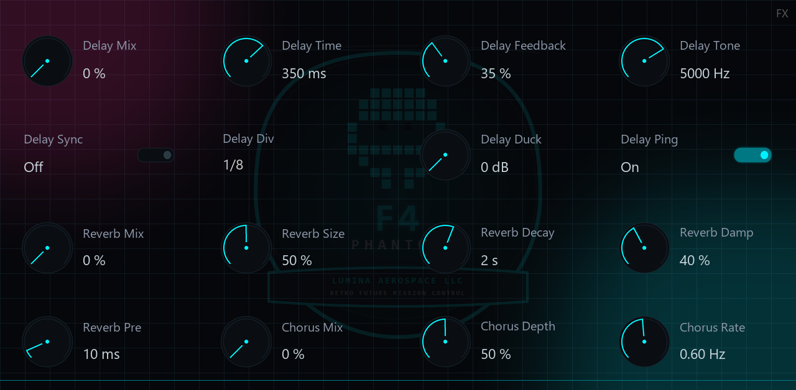

# F4 Phantom — 8-voice subtractive synthesizer for the Akai MPC



**Lumina Aerospace LLC.** A native MPC OS plugin (instrument) with its own touch screen, a real delay and a
real reverb, and a library of **194 factory sounds in 30 genres**.

## Lineage

F4 Phantom is named for the **F-4E**, the four-engine night fighter of the 1940s: the four barrels of the rotary
cannon, the dark cockpit, the telemetry. The plugin's **VULCAN** page is that cannon: a six-barrel rotary gate that
spools up from rest on every note and fires in a fixed rotating pattern.

## What it is

- **Eight voices** of subtractive synthesis: two PolyBLEP oscillators (saw, square, triangle, sine) with a
  semi-detune, a sine sub one octave down, a state-variable filter with drive, and a full envelope pair.
- **A sub-oscillator, analog drift and glide**, so a held note breathes instead of sitting still.
- **A tempo-syncable LFO**, a **pitch bend** and **mod-wheel vibrato**.
- **A stereo chorus**, a **tempo-syncable delay** with a fractional read and a saturated feedback path, and a
  **plate reverb** whose decay is calculated from the RT60 you ask for.
- **The VULCAN rotary gate**, the one that is not in any other synth.

## The factory library

**194 programs: the fourteen originals plus 180 more, in 30 genres.**



Every family of every genre: **LEAD**, **BASS**, **KEY**, **PAD**, **STRINGS** and **BRASS**. The genres are
8BIT, ACID, AMBIENT, BREAKBEAT, COUNTRY, DISCO, DISCO HOUSE, DNB, DUBSTEP, EDM, ELECTRO, FUNK, GOSPEL, HARDSTYLE,
HIPHOP, HOUSE, INDIE, INDUSTRIAL, JAZZ, LATIN, LOFI, POP, PSYTRANCE, RNB, ROCK, SYNTHWAVE, TECHNO, TRANCE, TRAP
and UKG.

The patches are named `<GENRE> <FAMILY>` — `EDM LEAD`, `HOUSE PAD`, `ACID BASS` — and the MPC sorts a plugin's
programs by name, so **the preset list groups itself by genre**, the way an MPC's own 808 or 909 kits do.

Every family starts from the same place: warm, a little driven, the chorus on and the delay and reverb in the mix.
The genre line is what changes it — Hardstyle's bass is heavy and saturated, Psytrance moves, Industrial is harsh
and resonant, Country is clean and twangy, Gospel has the tremolo, UK Garage is bouncy and shuffled, Disco House is
bright with a lot of chorus.

## Parameters

| Page | Parameters |
|------|------------|
| OSC | Volume, Osc1/2 Wave, Octave, Level, Semi, Detune, Pulse Width, Glide, Bend Range, Sub Level, Drift |
| FILTER | Cutoff, Resonance, Filter Mode (LP/BP/HP/Notch), Drive, Env Amount, Key Track, Filt Attack/Decay/Sustain/Release |
| AMP | Amp Attack/Decay/Sustain/Release, Velocity |
| LFO | Shape, Rate, Sync, Div, LFO>Pitch, LFO>Filter, Wheel Vib |
| FX | Delay Mix/Time/Feedback/Tone/Sync/Div/Duck/Ping, Reverb Mix/Size/Decay/Damp/Pre, Chorus Mix/Depth/Rate |
| VULCAN | Vulcan Depth/Rate/Spin/Spread |

Parameter order is permanent: new parameters are only ever appended, so old projects recall correctly.

## The delay and the reverb

**Delay.** The repeat length is read with a cubic interpolation, so it can land on a fraction of a sample and the
echo still arrives exactly where the music says it should — a whole-sample tempo grid never drifts. The length
glides when you change it, so a change never clicks. The feedback path is filtered, saturated and DC-blocked: the
repeats get darker as they go, the saturation is what stops a long tail from running away, and the DC block keeps
the tail centred. Ducking pulls the repeats down under a new note, and the sync division takes the tempo straight
from the host.

**Reverb.** A plate: four comb filters whose decay gain is calculated from the RT60 you asked for, two allpasses to
smear the early reflections, eight early-reflection taps in front, and a slow drift on every comb so the tail does
not ring on a fixed grid. The level does not change with the decay time: a long tail is a long tail, not a louder one.

## Status: please read

**Tested on hardware.** A user loaded F4 Phantom on a **Gen2 MPC (64-bit ARM, MPC OS 3.x)** and played it: the
plugin loads, it makes sound, and the sound was well received. That is a report from a user, not a claim from us
about every device or every firmware.

It builds clean for both MPC processors (32-bit ARM Cortex-A17 and 64-bit AArch64) and passes the MPC Plugin SDK's
host simulator (19 checks, no failures). Every one of the 194 factory programs was rendered and measured
(`tools/render_programs.cpp`): none is silent, none runs into the limiter, none produces a non-finite sample.

## CPU

About 0.1 % of one desktop core per instance at the SDK's default block size, measured on this machine. The delay
line and the reverb allocate their memory once, in `prepare()`, never in the audio thread.

## Install

Unzip the release and copy the folder `Lumina Aerospace LLC - VST - F4 Phantom` into `VST2 Plugins` on the MPC's
drive (`INSTALL.txt` in the zip has the steps). **One download works on both processors**: the release zip carries
the 32-bit and the 64-bit build, so there is no way to pick the wrong one.

Third-party plugins need MPC OS 3.10.1 or later, and **Preferences → Enhancements (Beta) → Enable Enhancements**
and **External Plugin Support** both switched on.

## Files

```
plugin.json           the manifest the MPC reads
ui.json               the layout of the touch screen (five pages plus VULCAN)
src/                  the plugin, and src/lumina/fx/ (the delay and the reverb)
skins/                the generated touch skin: the film strips and TUI.json
tools/                the skin pipeline (see the docstring in make_skin.py)
docs/screenshots/     the screens
OPERATORS_MANUAL.md   every parameter, explained
```

## Build

You need the [MPC Plugin SDK](https://github.com/inMusic-Brands) toolchain checked out next to this folder (its
`tools/build.py` and `framework/`), Python with Pillow, and the SDK's bundled zig. Then:

    python tools/build.py "<this folder>"                       # from the SDK root: native + arm32 + arm64 + validation
    python "<this folder>/tools/make_skin.py" "<this folder>"    # rebuild the touch skin (see its docstring)
    python "<this folder>/tools/make_house_skin.py" "<this folder>"   # the house controls: knobs, faders, background
    python tools/build.py "<this folder>"                       # again, so the skin is copied
    python tools/package.py "<this folder>"                     # the release zip

## License

MIT, Copyright (c) 2026 Lumina Aerospace LLC. See `LICENSE`, which also records the MIT-licensed MPC Plugin SDK
widgets used in the skin.

## Contact

Lumina Aerospace LLC — owner@luminousworksllc.com
